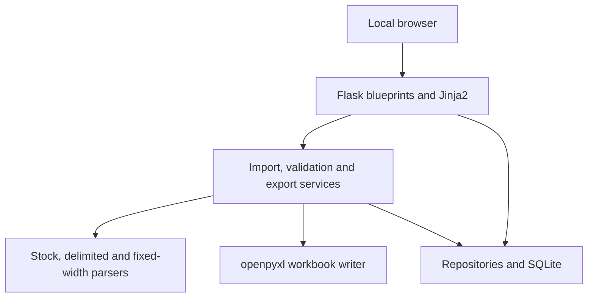
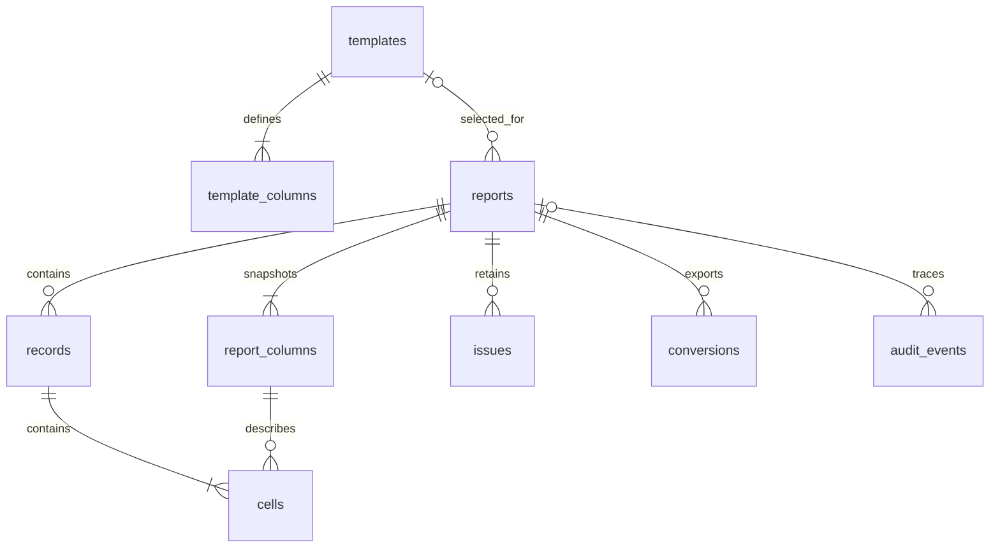

# High-level system design

## Architecture and technology decisions

The browser sends local HTTP requests to Waitress at 127.0.0.1:5000. Flask routes separate reports, mapping templates, record review and saved exports. Jinja2 renders HTML forms and escaped values. The services layer parses source text, validates records and constructs Excel. SQLite persists the source, rows, review decisions, snapshots and audit history in one local file.

Python/Flask/Jinja2 satisfy the course requirements and keep implementation understandable to the team. SQLite avoids an extra database service for the requested local POC. openpyxl writes real Excel tables and typed numeric cells. Waitress supports Windows and binds only to loopback. Plain local CSS/JavaScript avoids CDN availability and privacy dependencies.

No login is required by the retrieved brief. This POC therefore assumes a trusted workstation. Shared or public deployment requires authenticated users, authorization, HTTPS, resource management and a separately reviewed deployment plan. No external AI API sees uploaded reports. AI assistance in this package concerns development and design.

## OOP design

ReportParser defines the abstract parse interface. StockValuationParser, DelimitedParser and FixedWidthParser inherit it and supply different implementations. get_parser chooses the class through a factory. The import service calls parse without depending on the concrete class, demonstrating polymorphism. ParsedRecord and ParseResult dataclasses encapsulate structured results. ReportRepository hides retrieval SQL behind get, columns and records methods. Its _db member is conventionally non-public; Python does not enforce private access.

The design uses inheritance for a real variation point. Each parser has a separate responsibility. Controllers handle HTTP and feedback, services handle workflow rules, repositories handle data retrieval, and Jinja2 templates render presentation. There is no claim that all helpers need to be classes.

## Entity relationships

The detailed, executable schema is ovol/schema.sql. docs/data_dictionary.md records every column, PK, FK and constraint from that schema. Tables use surrogate integer primary keys except cells, whose key is (record_id,column_id). Each template/report column belongs to one parent, with unique positions and names within that parent. Monetary and quantity values stay as decimal strings in SQLite to avoid binary floating-point arithmetic; validated Decimal values become numeric XLSX cells. Blank optional values stay blank and zero stays zero.

## Normalization

Template names and parser settings depend on template_id. Template column definitions depend on their own ID, with candidate keys (template_id,position) and (template_id,name). Report-specific columns keep the import-time output schema. Records depend on record_id. Cell value depends on the full composite key (record_id,column_id), so the cells relation has no partial dependency. Template and column definitions are separated from records and cells, avoiding repeated current template settings in each transaction row. These operational relations meet at least 2NF.

reports.template_snapshot is an intentional immutable JSON document representing the complete import configuration at a historical moment. It is a provenance artefact, not the mutable relational source for template editing. conversions.artifact is an immutable document BLOB. audit_events.details is a historical event document. These stored documents should not be described as individually queryable normalized attributes.

## Parsing contract

Stock layout positions use zero-based half-open ranges: item code [0,16), description [16,48), warehouse [48,53), warehouse description [53,71), unit [71,78), cost [78,90), consignment [90,105), on-hand quantity [105,120), total value [120,end). Item group comes from ITEM GROUP headers. Continuations supply Description 2 and Dimensions. Form feeds and repeated page headers do not end a record. Recognised warehouse and grand totals are skipped because the client permits omission of subtotals.

The supplied file contains three reference-only mojibake endings in Excel. Verification explicitly removes only that known terminal sequence during reference-text comparison. It does not rewrite the uploaded bytes or numeric values. An entirely different complex report format is not covered by this stock parser.

Delimited and custom fixed-width parsers operate on one physical line per record. Delimited imports do not silently discard a heading row. A non-data header must be excluded during review. Multiline quoted CSV fields are unsupported by this parser and need a separate format adapter.

## Data integrity and error handling

Ingestion runs in one transaction. A bad file or invalid template creates no report. An identical source digest is rejected as a duplicate. Source bytes, text and digest are retained separately, allowing exact original download. Editing a record requires its expected revision; stale forms return 409. Export starts an IMMEDIATE transaction so its rows, issue decisions and audit data form a consistent snapshot.

The exporter blocks empty reports, invalid included records and open source issues. Required values, finite decimal syntax and Excel's 15 significant-digit limit are checked. Text cells are explicitly strings to prevent formula execution. Corrections, exclusions and deletions record reasons in audit history. Deleting a report cascades to its rows and exports while setting retained audit references to NULL. Audits are useful for review but are not tamper-proof: the trusted local operator has access to the SQLite file.

## Threats and proportional controls

| Threat | Implemented control | Residual boundary |
| --- | --- | --- |
| Oversized/binary input | 5 MB file rule, 6 MB request cap, TXT and encoding checks | Larger production workloads need queueing and stricter memory budgets |
| SQL injection | Bound SQL parameters and internal allowlist for table names | Future routes must preserve this pattern |
| HTML/script source values | Jinja2 autoescape and CSP | Teammates must avoid adding unsafe template rendering |
| Cross-site form writes | Per-session CSRF token, SameSite Strict, trusted hosts | This is not user authentication |
| Excel formula injection | Untrusted strings written with string cell type | Staff must still review financial meaning |
| Silent conversion loss | Included rows revalidated, unknown lines block export | Stock report adapters need regression samples |
| Stale edits/exports | Revision checks, transaction lock, immutable export bytes | No multi-user collaboration model |
| Public exposure | Loopback Waitress binding and no external dependencies | Local data is unencrypted and belongs on a trusted device |

Design record: ChatGPT/Codex assisted with the draft of this document. The team’s accepted changes, self-check, two peer annotations and tutor decision belong in docs/assessment_records/ai_collaboration.md and each member’s peer_review.md.
